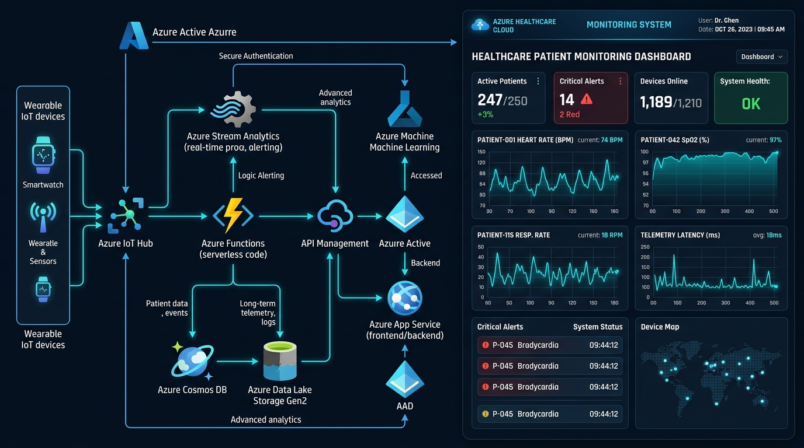

# Neetu Patel - Azure DevOps Engineer Portfolio

A premium, modern dark-themed portfolio website designed for **Neetu Patel**, Azure DevOps Engineer.



---

## 🌟 Key Features

- **Modern Dark Theme**: Engineered with deep obsidian backgrounds (`#070B14`), Microsoft Azure blue (`#0078D4`), and cyber cyan (`#00D2FF`) glow accents.
- **Hero Section**: 
  - Dynamic subtitle typing effect showcasing key specializations.
  - Interactive **Live Azure DevOps Pipeline Simulator & Terminal Console** with real-time log output and replay button.
  - Quick impact metrics (100% IaC Automated, 99.9% Uptime Mindset, Zero Downtime Deployments).
  - Quick action buttons: **Explore Projects**, **Download Resume**, **Get In Touch**, **GitHub**, and **LinkedIn**.
- **About Me**: Professional summary, engineering pillars (IaC First, Automated CI/CD, DevSecOps Mindset, Observability First), and certification badges (AZ-400, Terraform Associate, AZ-900).
- **Technical Skills Matrix**: 
  - Full coverage of all 8 core technical skillsets:
    1. Microsoft Azure
    2. Terraform & Infrastructure as Code
    3. Azure DevOps CI/CD Pipelines
    4. Docker & Kubernetes (AKS)
    5. Git & GitHub
    6. Azure Key Vault
    7. Azure Monitor & Log Analytics
    8. Linux & Networking
  - Interactive category filter tabs (Cloud, IaC, CI/CD, Containers, Security).
- **Featured Projects**:
  1. **Healthcare Patient Monitoring System hosted on Azure** (HIPAA-compliant telemetry stream architecture)
  2. **Azure Infrastructure Automation using Terraform** (Modular Hub-and-Spoke topology with Azure Blob state locking)
  3. **CI/CD Pipeline with Azure DevOps** (Multi-stage YAML pipeline with automated gates and container scans)
  4. **Kubernetes Application Deployment** (Production AKS cluster with Helm, HPA, and Key Vault CSI driver)
  - Interactive **Deep Dive Modal** for each project with challenge, solution, and business metrics.
- **Interactive Architecture Playground**: Clickable 6-stage DevOps lifecycle viewer showing real YAML, Terraform HCL, and KQL alert queries.
- **Career Roadmap / Work Experience**: Chronological glowing timeline of enterprise DevOps achievements.
- **Contact Section**: Working interactive contact form with validation, success notifications, direct social buttons, and 1-click **Copy Email** to clipboard.
- **Executive Resume**: Dedicated print-ready and downloadable resume file ([`resume.html`](resume.html) and [`assets/docs/Neetu_Patel_Azure_DevOps_Resume.html`](assets/docs/Neetu_Patel_Azure_DevOps_Resume.html)) with 1-click "Print / Save as PDF".

---

## 📁 Project Structure

```text
terraform/
├── index.html                   # Main single-page portfolio application
├── resume.html                  # Print-ready & downloadable resume page
├── README.md                    # Portfolio documentation & instructions
├── css/
│   └── style.css                # Pure CSS3 styling (dark theme, variables, responsive design)
├── js/
│   └── script.js                # Vanilla ES6 JavaScript (terminal, typing, modals, filters)
└── assets/
    ├── docs/
    │   └── Neetu_Patel_Azure_DevOps_Resume.html # Formatted resume
    └── images/
        ├── neetu_patel.jpg          # Professional portrait headshot
        ├── healthcare_azure.jpg     # Healthcare patient monitoring system architecture
        ├── terraform_automation.jpg # Terraform infrastructure automation diagram
        ├── azure_cicd_pipeline.jpg  # Azure DevOps CI/CD pipeline screenshot
        └── kubernetes_aks.svg       # Production AKS cluster topology diagram
```

---

## 🚀 How to Run & View

### Option 1: Direct File Open
Double-click `index.html` in your file explorer, or right-click `index.html` -> **Open with Google Chrome / Microsoft Edge / Firefox**.

### Option 2: VS Code Live Server
1. Open this repository in VS Code.
2. If you have the "Live Server" extension installed, right-click `index.html` and click **"Open with Live Server"**.

### Option 3: Deploy to GitHub Pages (Free)
1. Commit and push the repository to GitHub:
   ```bash
   git add .
   git commit -m "Add modern Azure DevOps portfolio website"
   git push origin main
   ```
2. In your GitHub repository settings, go to **Pages** -> Select the `main` branch -> Click **Save**.
3. Your portfolio will be live at: `https://patelneetu10-stack.github.io/terraform/`

---

## 🔗 Connected Profiles
- **GitHub**: [https://github.com/patelneetu10-stack](https://github.com/patelneetu10-stack)
- **LinkedIn**: [https://linkedin.com/in/neetu-patel](https://linkedin.com/in/neetu-patel)
- **Email**: `patelneetu.devops@gmail.com`